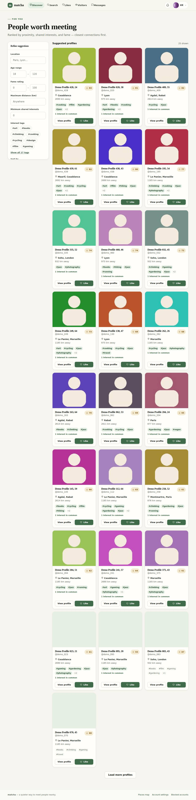
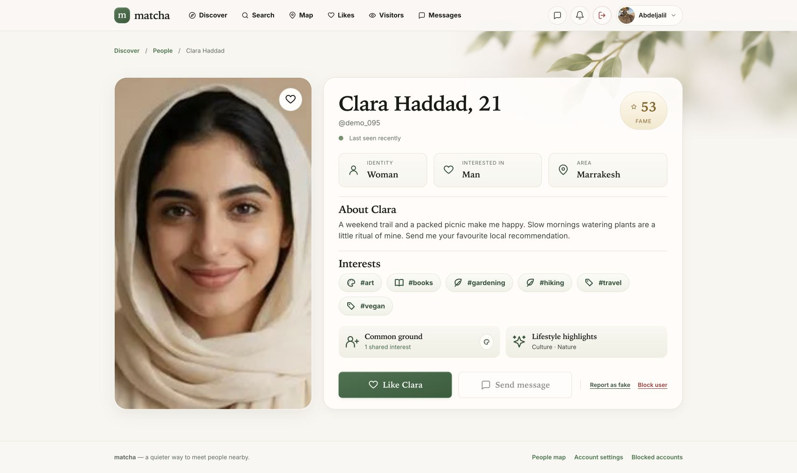
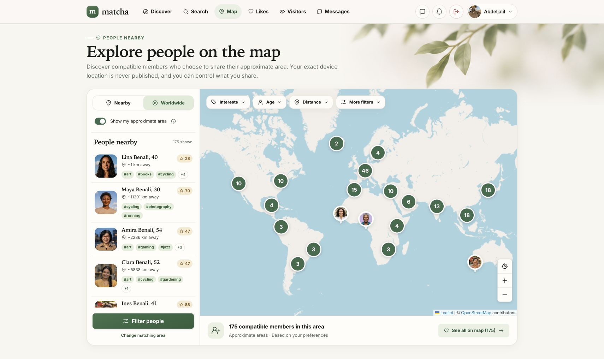
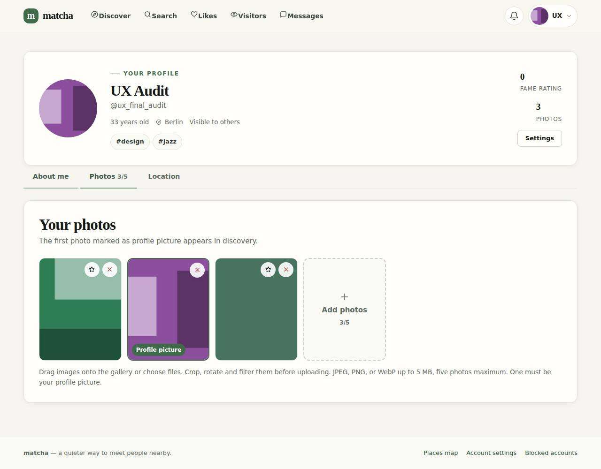
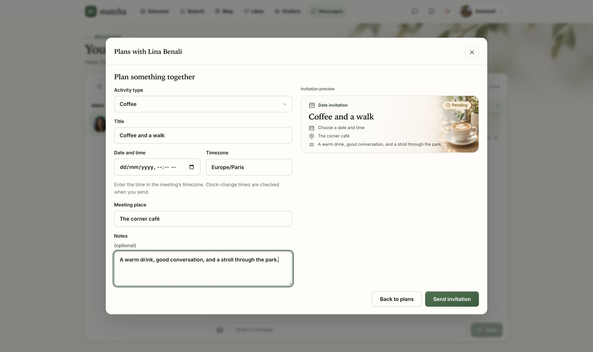
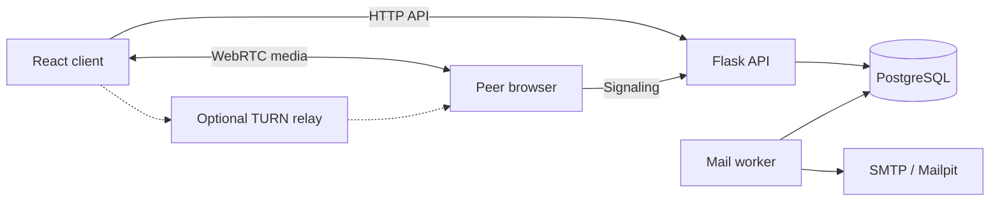

# Matcha

[](https://github.com/abdeljalil-salhi/matcha/actions/workflows/backend.yml)
[](https://github.com/abdeljalil-salhi/matcha/actions/workflows/frontend.yml)
[](https://github.com/abdeljalil-salhi/matcha/actions/workflows/codeql.yml)

[](server/)
[](frontend/)
[](frontend/)
[](sql/)

**A quieter way to meet people nearby.**

Matcha is a full-stack dating app built for the 42 web curriculum. Discover
people through shared interests, connect through mutual likes, and move from
conversation to real plans with chat, audio/video calls, and date invitations.

[Quick start](#quick-start) · [Features](#features) · [Architecture](#architecture) · [Development](#development) · [Documentation](#documentation)



## Features

| | What you can do |
| --- | --- |
| **Your profile** | Write a bio, choose preferences and interests, upload up to five photos, and pick a profile picture. Crop, rotate, filter, or enhance photos with a before/after preview. |
| **Discovery** | Browse recommendations or search by age, location, distance, fame, and shared interests. Explore compatible members on an interactive map with optional approximate-area sharing. |
| **Connections** | Like each other to unlock messaging. See incoming likes, profile visitors, online status, and notifications. Block members or report fake accounts. |
| **Conversations** | Exchange messages and GIFs, see read receipts, and start one-to-one audio or video calls with a connection. |
| **Date plans** | Choose an activity, preview the invitation as you type, and send it in chat. Accept, decline, reschedule, or cancel plans, then find upcoming invitations and confirmed dates in Calendar. |
| **Accounts** | Register with email verification, recover a password, confirm email changes, or use optional Google sign-in. |

### A look inside

| Profiles | People map |
| --- | --- |
|  |  |

| Photo gallery | Live invitation preview |
| --- | --- |
|  |  |

See the [screenshot gallery](docs/EXAMPLES.md) for chat, Calendar, and location flows.

## Quick start

Install **Docker with Compose v2** and **Make**, then run from the repository root:

```sh
make
```

`make up` and `make dev` are aliases. Docker installs dependencies, creates missing
local environment files with random development secrets, applies database
migrations, and starts the stack. No host Python, Node, npm, or virtual environment
is required. The first run downloads images and dependencies.

| Service | Default URL |
| --- | --- |
| Matcha | [localhost:5173](http://localhost:5173) |
| Interactive API docs | [localhost:8000/docs](http://localhost:8000/docs) |
| Local email inbox (Mailpit) | [localhost:8025](http://localhost:8025) |

Register through the app and open Mailpit to follow the verification email, or
populate the app with demo profiles:

```sh
make seed
```

Stop the services with `make down`; database volumes are retained. Use
`make logs SERVICES='frontend api worker'` to inspect logs, or `make help` for
the full command list.

### Try the complete flow

Seeding creates **500 fictional profiles**, with bundled AI-generated adult
portraits, biographies, interests, and sample likes and visits.

1. Sign in as **`demo_001`** and **`demo_002`** in separate browser profiles or sessions.
   Both use the locally generated **`SEED_PASSWORD`** from `.env`.
2. Find each other's profiles and exchange likes to connect.
3. Open Messages, send a message, and check notifications and read receipts.
4. Propose a date, choose an activity, and watch the invitation preview update.
5. Respond from the other account, then open **Account menu → Calendar**.
6. Try rescheduling or cancelling a plan, or start an audio/video call.

Reseeding revokes existing evaluator sessions. Portrait provenance is recorded in
the [asset source notes](server/jobs/assets/portraits/SOURCE.md).

### Use another device

For LAN/Wi-Fi access, configure `.env.lan` from `.env.lan.example`, then run:

```sh
make up-lan
```

Follow the [LAN setup guide](docs/SETUP.md#local-network-access-lan--wi-fi)
for addresses and configuration. Camera and microphone access require localhost
or HTTPS; see [HTTPS for LAN](docs/SETUP.md#https-for-lan-recommended-for-calls).

## How matching and plans work

**Recommendations respect mutual preferences.** The same area is prioritized,
then the same city. Within those groups, ranking combines proximity, shared
interests, and fame. You can change the sort order or narrow the results with
filters. The [ranking implementation](server/profiles/ranking.py) contains the
scoring rules.

**Fame reflects interactions.** Each received like contributes four points and
each distinct unblocked profile visitor contributes one, capped at 100.

**Mutual likes create a connection.** Messaging and calls are available to
connected members. Blocking or ending the connection stops further communication
and updates the associated plans.

**Invitations keep their history.** Coffee, food and dining, outdoors, arts and
culture, and other activities have their own card backgrounds. Responses and
reschedules appear in the conversation, while the planner shows current details.
Meeting times include a timezone, with daylight-saving transitions checked when
submitting a proposal.

## Architecture

| Layer | Technology |
| --- | --- |
| Frontend | React, TypeScript, Vite, Leaflet |
| API | Python 3.12, Flask, Gunicorn |
| Database | PostgreSQL 17, handwritten SQL and versioned migrations; no ORM |
| Email | Database-backed mail queue, background worker, Mailpit locally |
| Calls | WebRTC media, API signaling, optional STUN/TURN configuration |
| Local environment | Docker Compose and Make |



The frontend proxies `/api` to Flask during local development. Chat,
notifications, and date plans refresh through two-second polling. Call signaling
also uses polling; media travels between browsers, directly or through TURN.

## Security and privacy

- Passwords use Argon2id. Session tokens are hashed in the database and delivered
  through HttpOnly, SameSite cookies, with origin checks for state-changing requests.
- Account verification and recovery use time-limited, single-use links. Optional
  Google authentication uses OAuth 2.0/OIDC with PKCE.
- Database access uses parameterized SQL and allowlisted dynamic query options.
  User text is rendered without injecting HTML.
- Uploaded images are validated, decoded, and re-encoded with metadata removed;
  ownership, file size, pixel count, and photo-count limits are enforced.
- Device location requires consent. Map visibility is separately opt-in and uses
  approximate areas. Public profiles omit email, exact birth date, and precise coordinates.

## Development

Run the checks through Docker:

```sh
make lint            # Black formatting check and Flake8
make backend-test    # Pytest with an isolated PostgreSQL test database
make frontend-test   # Vitest
make frontend-build  # TypeScript checks and Vite production build
make check           # All four checks above
make smoke           # Isolated startup, email, login, and proxy smoke test
```

See [Development and CI](docs/DEVELOPMENT.md) for targeted test runs, formatting,
and workflow details.

## Documentation

| Guide | Contents |
| --- | --- |
| [Setup and configuration](docs/SETUP.md) | Environment files, demo data, Google sign-in, LAN access, and HTTPS |
| [API integration guide](docs/API.md) | Account, profile, discovery, relationship, and messaging contracts |
| [OpenAPI specification](server/docs/openapi.json) | Machine-readable endpoint definitions, including date plans and calls |
| [Audio/video calls](docs/CALLS.md) | Signaling, STUN/TURN, and network setup |
| [Development and CI](docs/DEVELOPMENT.md) | Tests, linting, formatting, and automated checks |
| [UI screenshots](docs/EXAMPLES.md) | Fresh captures of the current application |
| [Frontend guide](frontend/README.md) | Frontend structure and development details |
| [Project subject](en.subject.pdf) | Original 42 requirements |

## Repository layout

```text
frontend/   React app, styling, and static assets
server/     Flask routes, services, jobs, and OpenAPI specification
sql/        PostgreSQL schema migrations
tests/      Backend integration and smoke tests
infra/      Container and local infrastructure configuration
docs/       Setup, API, calling, and development guides
```

When changing an endpoint, update the [API guide](docs/API.md) and
[OpenAPI specification](server/docs/openapi.json) alongside the implementation.
