# UI screenshots

## Discovery and profiles

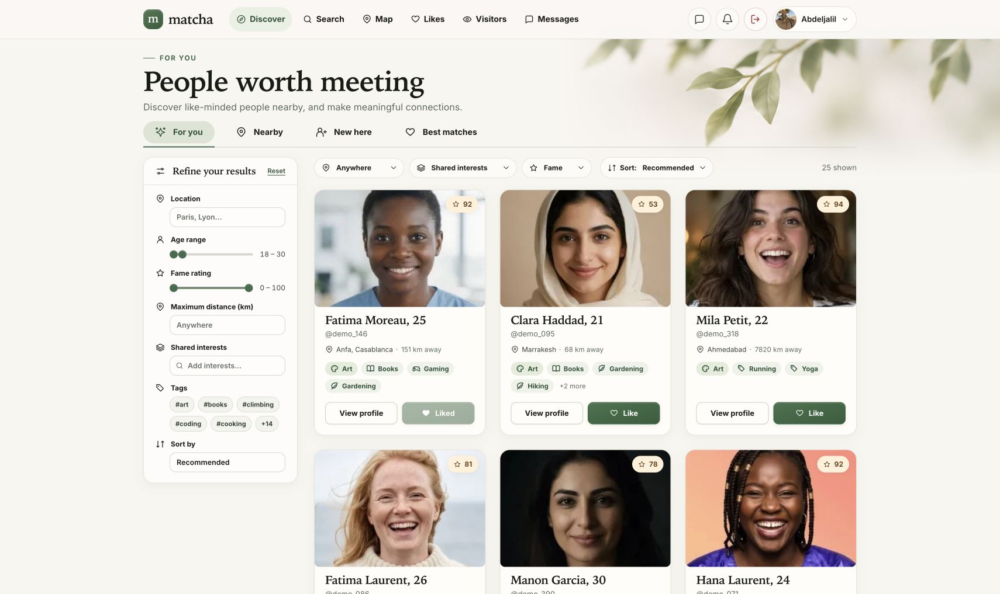

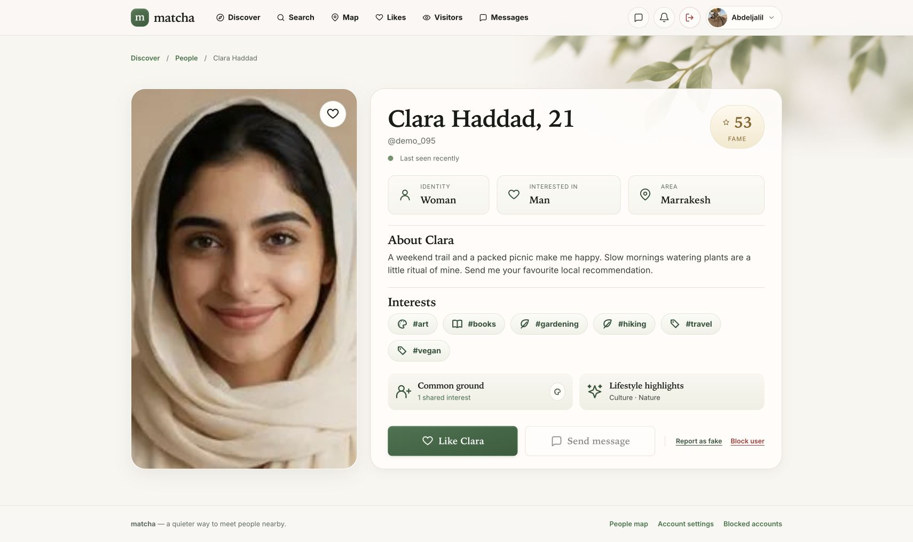

## People map

The worldwide view groups opted-in members into clusters. Location sharing is
controlled separately from the matching area.

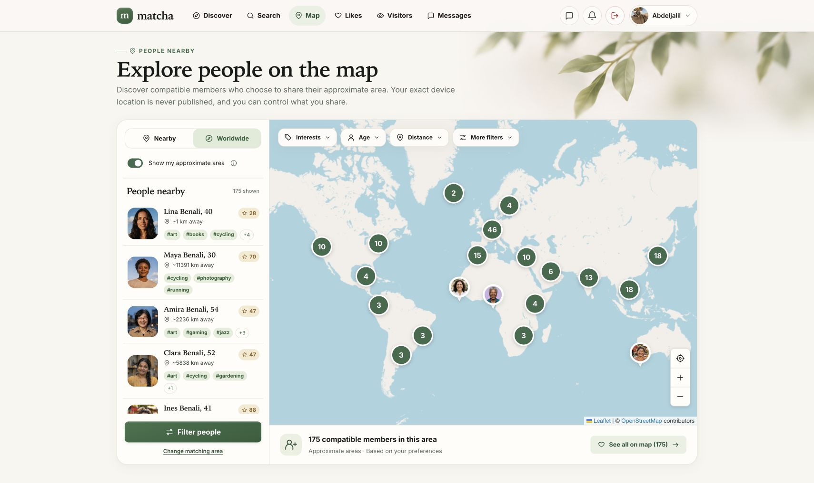

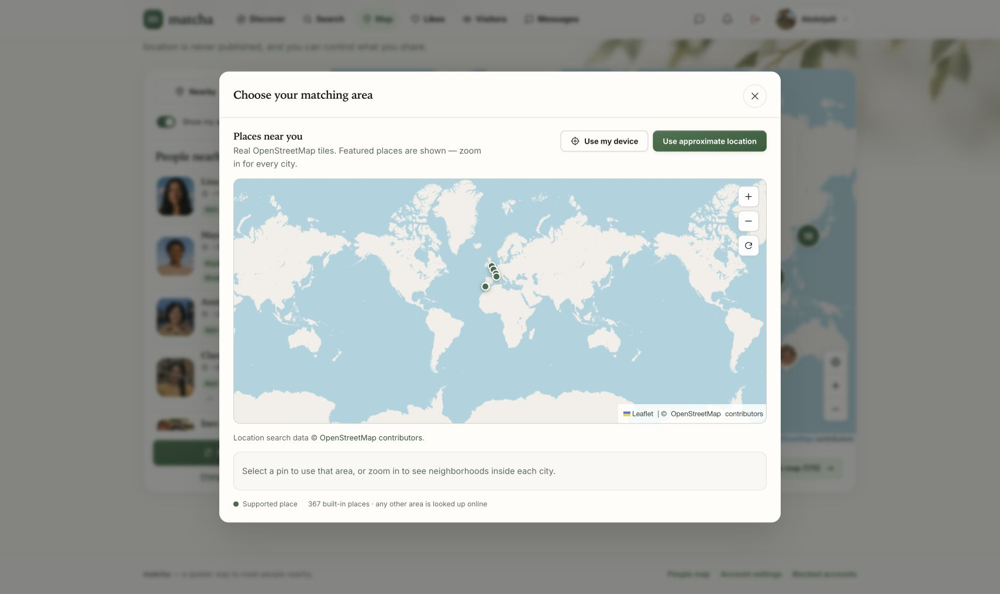

## Profile management

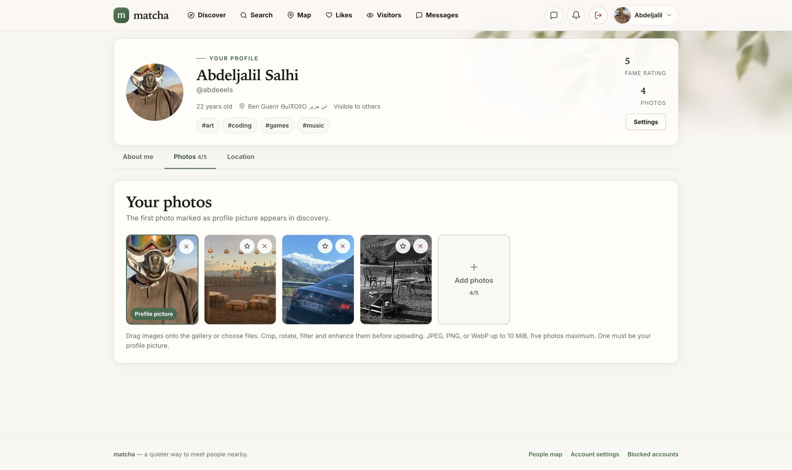

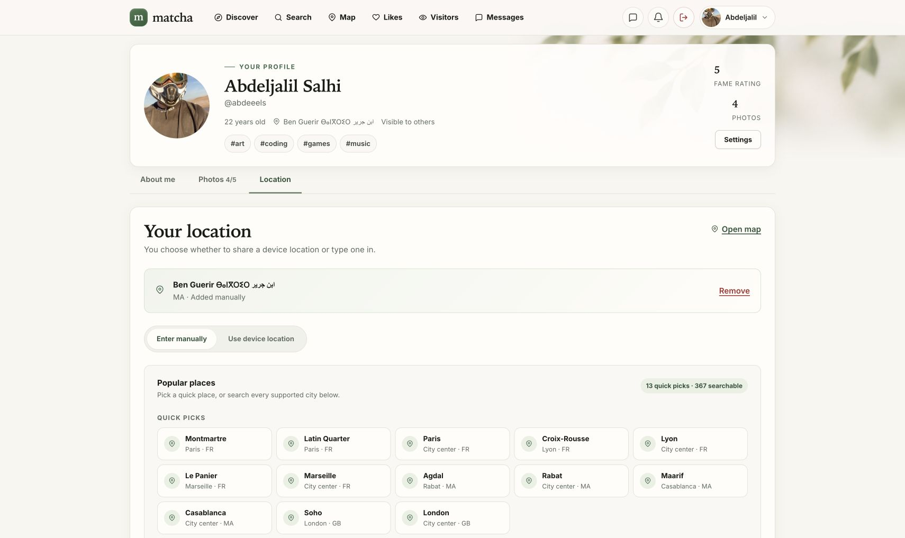

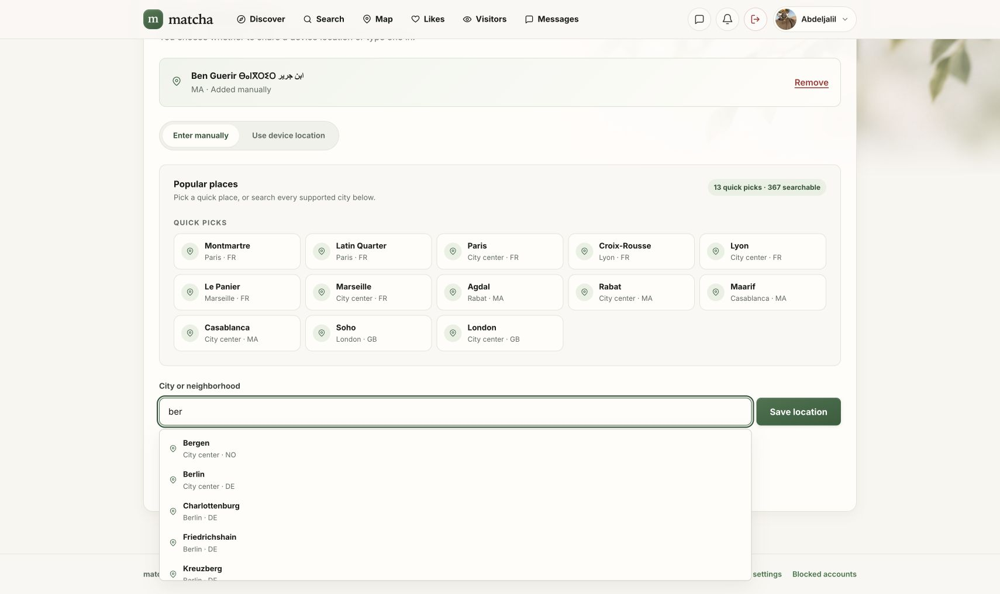

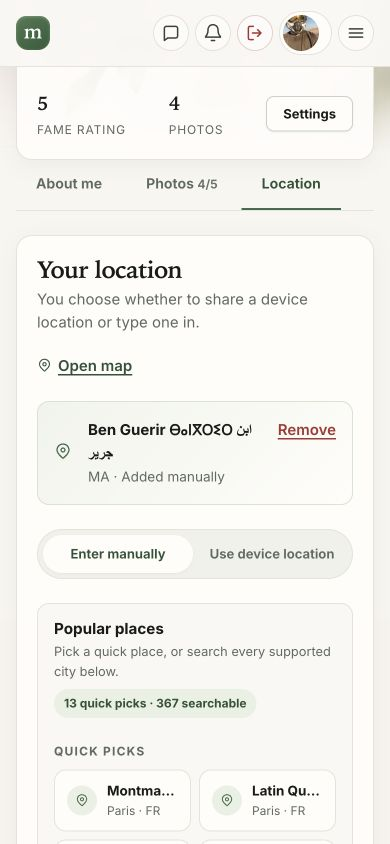

## Conversations and invitations

Chat includes date-plan history, read receipts, and call controls. Cancelled cards
use the yellow status treatment.

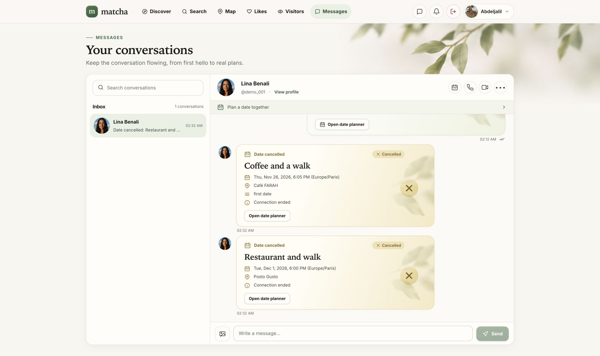

The invitation preview reflects the draft's activity, title, meeting place, and
notes. This capture shows an unsent draft with the date still to be chosen.

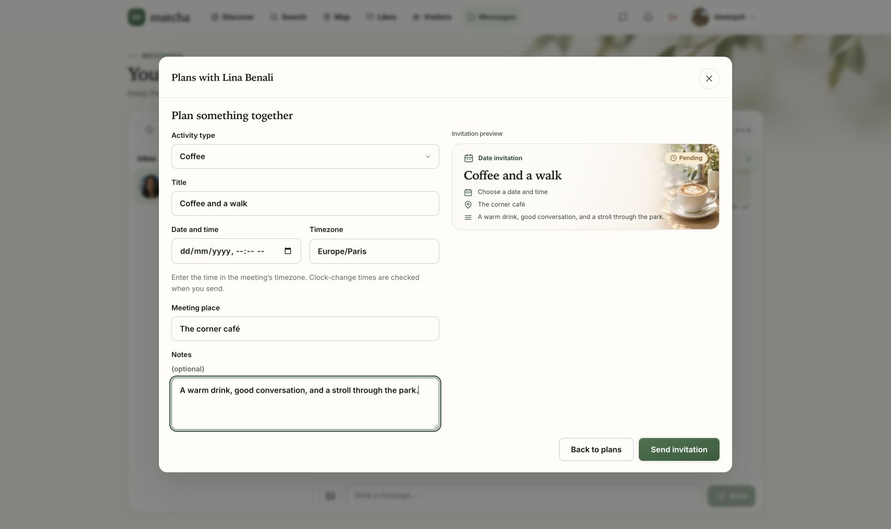

## Calendar

The account menu opens the monthly calendar. This capture shows its empty state;
pending invitations and confirmed plans appear here when available.

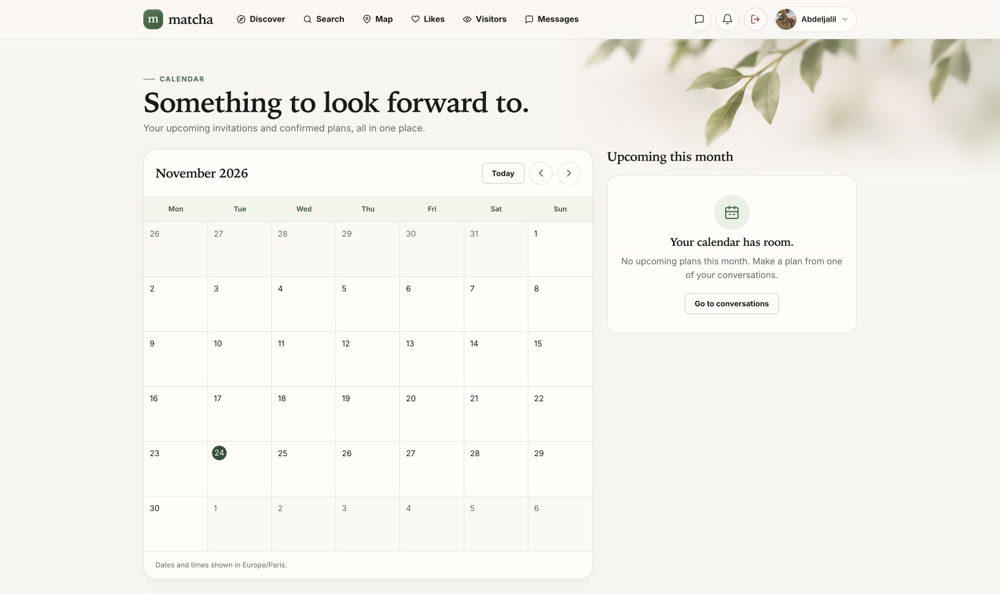
